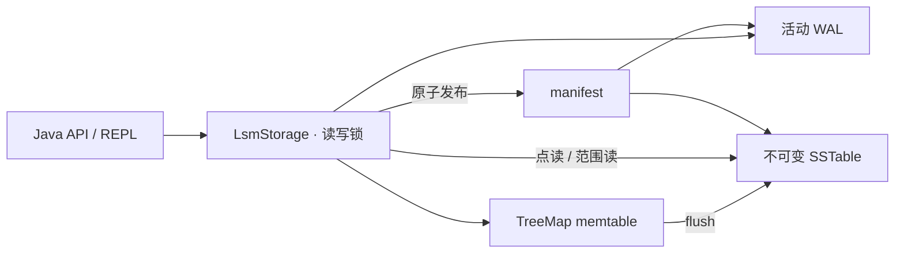

# kvlite-java

kvlite-java 是一个 Java 21 嵌入式 LSM-tree 字符串键值引擎，提供 WAL 恢复、稀疏索引 SSTable、范围扫描、全量 compaction 和同实例并发访问。



## 构建和启动

安装 JDK 21，确认 `java -version`。运行引擎不需要第三方库。

```sh
./mvnw verify
java -cp target/kvlite-java-0.1-SNAPSHOT.jar kvlite.Repl ./demo-data
```

在 Windows 上用 `.\mvnw.cmd verify` 构建，Java 启动命令相同。每个数据目录须由一个实例独占。用同一目录重启会读取原有数据。

REPL 支持 `put <key> <value>`、`get <key>`、`delete <key>`、`scan <from-inclusive> <to-exclusive>`、`stats` 和 `compact`。输入按空白分隔。用双引号输入含空白的参数或空字符串，引号内用 `\"` 和 `\\` 表示引号和反斜杠。EOF 关闭实例。写入或 compaction 遇到关闭实例的 I/O 错误时，REPL 会提示用同一目录重开。

以下会话取自打包后的 REPL 在空数据目录上的实跑，使用当次送入的命令显示输入行：

```text
kvlite> put apple red
OK
kvlite> put "green tea" "in stock"
OK
kvlite> get apple
"red"
kvlite> scan a z
"apple" "red"
"green tea" "in stock"
2 result(s)
kvlite> delete apple
OK
kvlite> get apple
(missing)
kvlite> stats
sstables=0 memtableBytes=22 walBytes=101
kvlite> compact
OK
kvlite> get
Input error: Usage: get <key>
kvlite> scan z a
Input error: Scan lower bound exceeds upper bound
```

`stats` 返回活动 SSTable 数、memtable 中最新条目的 UTF-8 key/value 估算字节数和活动 WAL 文件字节数，WAL 统计包含文件头和帧开销。上面没有触发 flush，所以 compaction 直接返回。Java API 也可显式调用 `flush()`。

## 测试和 CI

`./mvnw verify` 跑 JUnit 5、构建 JAR，并执行 JaCoCo 的 85% 行覆盖率门槛。[Verify 工作流](.github/workflows/verify.yml) 在 push 和 PR 上用 JDK 21 检查 Ubuntu 和 Windows。测试包括 WAL 恢复、manifest 提交前后重开、5,000 步固定种子 TreeMap 对照、REPL 和 latch 控制的并发测试。覆盖率报告位于 `target/site/jacoco/index.html`。

Compaction 并发测试在 compaction 取得写锁后暂停，验证此时 `get` 和 `put` 会阻塞。测试没有单独验证 `scan` 和 `flush` 的锁覆盖，也无法发现 manifest 提交后、切换 SSTable reader 前的短暂放锁。

## Benchmark

```sh
java -cp target/kvlite-java-0.1-SNAPSHOT.jar kvlite.Benchmark
```

2026-11-24 在同一台 Windows 11 主机上串行启动三个 JVM。当时在 benchmark 主机上运行 `Get-CimInstance Win32_Processor | Select-Object Name,NumberOfCores,NumberOfLogicalProcessors`，Windows 报告 Intel Core i9-13900H、6 核 / 12 逻辑处理器。主机内存为 31.64 GiB。临时目录位于 C:，使用 NTFS 和 Samsung MZVL21T0HCLR-00B00 NVMe SSD。系统版本为 10.0.26200 x64，运行时是 Eclipse Adoptium 25.0.2，JAR 编译目标为 Java 21。

| JVM | 写入 ops/s（秒） | 随机点读 ops/s（秒） | 命中率 |
| --- | ---: | ---: | ---: |
| 1 | 461.35（10.837836） | 6,392.45（3.128689） | 10,025 / 20,000（50.13%） |
| 2 | 448.02（11.160126） | 6,108.40（3.274180） | 10,025 / 20,000（50.13%） |
| 3 | 453.50（11.025411） | 6,307.13（3.171015） | 10,025 / 20,000（50.13%） |
| 三次吞吐中位数 | 453.50 | 6,307.13 | 50.13% |

- 单线程。每次先在独立的临时数据库预热 1,000 次写和 1,000 次读，再在空临时数据库测 5,000 个不同 key 的写入和 20,000 次随机点读。key 为 `key-<n>`，value 为 128 字节。读目标由固定 seed 12345 从 10,000 个候选 key 中有放回抽取。
- 默认阈值为 4 MiB memtable 或 16 MiB WAL，实测负载未触发自动 flush。每次写的计时包含 WAL 帧写入和 `force(true)`。显式 flush 在写入计时结束后、点读计时前完成，点读查询 SSTable。
- 用 `System.nanoTime()` 分别计时两段操作循环。键生成、预热、打开、显式 flush、关闭和清理均在计时外。保留同一 JVM 和操作系统缓存，未清理页缓存。此表描述这一小数据集上的本地同步写和 flush 后读。

## 读代码

[阅读指南](docs/READING_GUIDE.md) · [架构](docs/ARCHITECTURE.md) · [文件格式](docs/FILE_FORMAT.md) · [设计决策](docs/DECISIONS.md) · [面试笔记](docs/INTERVIEW_NOTES.md)
