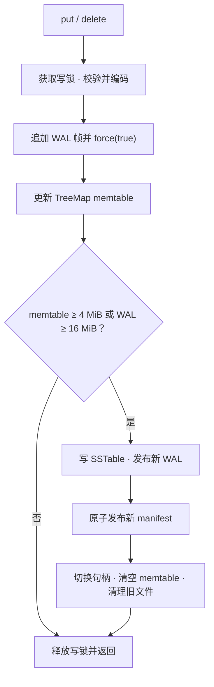
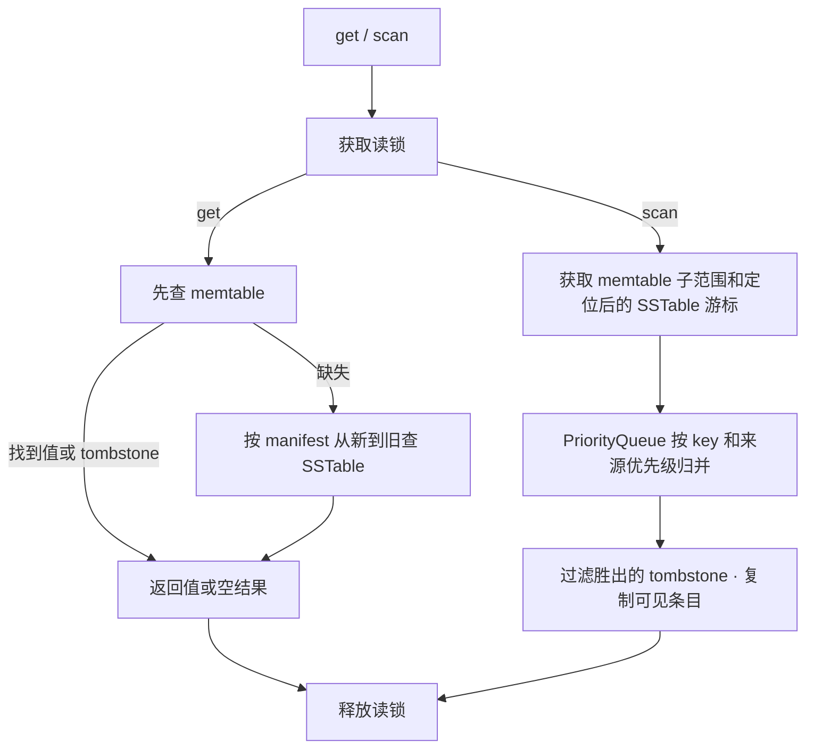

# kvlite-java 架构

`Storage` 接收字符串操作。一个 `LsmStorage` 实例拥有一个数据目录、一个活动 WAL、一份 memtable，以及由最新 manifest 指定的 SSTable 读句柄。打开成功后，同一实例可由多个线程调用。

## 写入与 flush

手动 flush 走同一提交路径。WAL 在 memtable 变更前同步，让进程退出后的恢复能以日志重建尚未刷盘的数据。自动 flush 发生在写完一条记录之后，阈值可以越过一条记录。写入或维护发生 I/O 错误时，实例在释放写锁前关闭。调用方须重新打开，失败写入可能已经生效。

## 点读与范围读

点读只扫每个候选表的一个稀疏索引区间。范围为 `[fromInclusive, toExclusive)`，同 key 只保留最新版本。多个读者可以共享只读文件句柄，各游标用独立偏移定位读取。读 I/O 错误会报告给调用方。

## 提交与恢复

| 退出时刻 | 重开时选择 | 回收条件 |
| --- | --- | --- |
| flush 发布 manifest 前 | 旧 manifest 和旧 WAL | 新表和新 WAL 是孤儿 |
| flush 发布 manifest 后 | 新 manifest、新 WAL 和已发布的表 | 旧 WAL 脱离引用 |
| compaction 发布 manifest 前 | 旧表和原 WAL | 归并输出是孤儿 |
| compaction 发布 manifest 后 | 合并结果和原 WAL | 输入表脱离引用 |

启动先验证最高编号的最终 manifest 及引用表，再重放活动 WAL，成功后清理未引用文件。Compaction 流式归并所有磁盘表，保持活动 WAL 和 memtable，关闭旧表句柄后才清理。全程持写锁，请求可能等待整个归并。清理删除失败会记录，重开可重试。提交模型限于支持同目录原子移动的本地文件系统上的进程退出。

## 模块职责

| 模块 | 职责 |
| --- | --- |
| `Storage`、`LsmStorage`、`Stats` | 对外 API、单把读写锁、快照与生命周期 |
| `Entry`、`EntryCodec`、`Memtable` | 值和 tombstone、严格 UTF-8 编码、有序的内存最新版本 |
| `Wal`、`TableSet` | 可校验的日志帧、恢复、manifest 发布及旧文件回收 |
| `SSTableWriter`、`FileSSTableReader`、`TableCursor` | 顺序发布不可变表、稀疏索引、按位置读取 |
| `EntrySource`、`MergingIterator` | 可抛 I/O 错误的有序游标和跨源去重 |
| `Repl`、`Benchmark`、`BenchmarkWorkload` | 命令接口和独立的可复现基准 |

`get`、`scan`、`stats` 持读锁，`put`、`delete`、`flush`、`compact`、`close` 持写锁。写失败沿已有写锁关闭资源。一个目录由一个实例独占，跨实例和跨进程协调由调用方负责。
